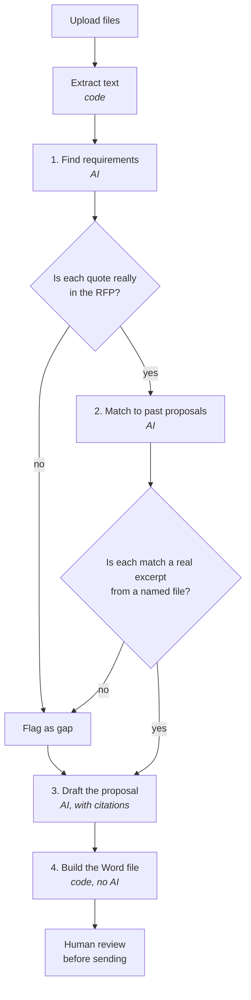

# RFP Response Generator

Turns **2–5 past winning proposals** and a **new RFP or security questionnaire** into a **cited first-draft proposal** in Word (.docx).

It's built to show gaps and conflicting claims instead of quietly inventing answers.

> **Status: prototype, pre-pilot.** Verified with automated tests and synthetic data. The source code is private; a walkthrough is available on request.

---

## The business problem

Vendors answering RFPs and security questionnaires usually copy from old proposals. That's slow, and it's risky:

- Old proposals contradict each other. For example, one says *SOC 2 Type II (2024)* and an older one says *SOC 2 Type I (2022)*; one promises *$2M* insurance and another *$1M*.
- Copy-paste hides which requirement each answer is meant to cover, so some get missed.
- A confident but unsupported claim in a proposal can turn into a contractual problem later.

**The goal:** a faster first draft where every claim can be traced to a source, and where anything missing or contradictory is shown to a person instead of being smoothed over.

## What it does

| Input | Output |
|---|---|
| 2–5 past proposals (PDF, Word, Excel, text) | A checklist of every requirement in the RFP, quoted word for word |
| 1 new RFP or questionnaire (PDF, Word, or Excel with one question per row) | For each requirement, the best supporting passage from past proposals, with its file name |
| | Conflicts between past proposals, flagged |
| | Requirements with no support, flagged as **gaps** |
| | A drafted proposal as a .docx, ready to finish in Word |

## How it works

Three steps use AI. Everything around them (file extraction, checks, formatting) is ordinary code, so it behaves the same way every time.

## Key design decisions

1. **No quote without a source.** Every requirement the AI extracts must appear word for word in the uploaded RFP. Every match must be a literal excerpt from a named past proposal. If not, it becomes a visible gap rather than a sentence in the draft.
2. **Conflicts are shown, not resolved.** When past proposals disagree, the tool shows both versions and the person decides.
3. **File names must be unique,** so every citation points to exactly one document.
4. **Formatting is code, not AI.** The Word document is built by deterministic code, so the AI can't change the structure.
5. **A human approves.** Prices, dates, customer names, legal promises and security or compliance claims are always for a person to verify.
6. **Uploaded documents are treated as untrusted.** Content inside an RFP can't override the tool's instructions.

## Quality and security checks

- Login is required in production mode: the app refuses to run without a password. Sessions are signed and expire after 8 hours.
- Login attempts are rate-limited, and requests from other websites are blocked.
- Upload limits are 25 MB per file and 75 MB per request.
- 12 automated tests cover login, rate limits, upload rules and the source-quote checks.
- An end-to-end self-test runs with simulated AI responses and produces a real .docx.
- A browser test runs with all outside internet access blocked, proving the test setup can't call external services.
- No known vulnerabilities were found in the dependency audit at the last review (August 2026).
- Uploaded files stay only in memory and are gone when the server restarts.

## Current status and next steps

**Verified:**
- Upload and text extraction on a real 26-page public-sector RFP (Managed IT Services).
- The full workflow, using simulated AI responses.

**Not yet measured:** the quality of live AI output on real documents.

**Next steps:**
1. Run the first live end-to-end test and measure quality and cost per proposal.
2. Run a pilot with one team using their own past proposals.
3. Before any wider use: individual user accounts, durable job storage, and a retention policy.

## My role

I defined the problem and the requirements: the source-quote rule, conflict handling, gap reporting and the human-review step. I directed the build with AI coding tools (Claude Code), and ran and reviewed the verification.

**Built with:** Next.js · TypeScript · Claude API · docx · pdf-parse · mammoth · ExcelJS
